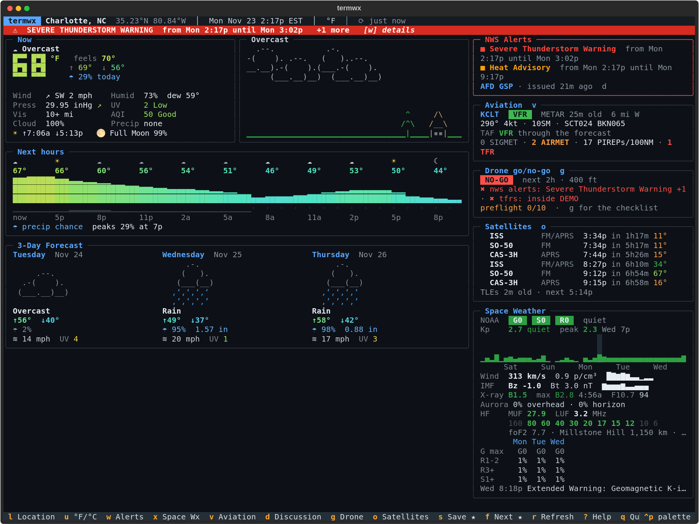
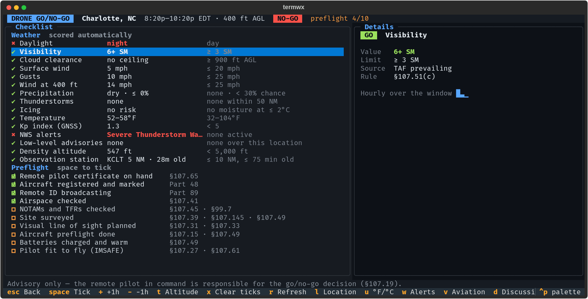

# termwx

ok. ok ok ok. so this is a terminal weather and aviation situational awareness thing and it
does, uh, everything? live conditions with an animated ASCII sky (yes the clouds move, yes
i spent too long on that), 24–36h hourly graph, 3-day forecast, NWS severe weather alerts,
a NOAA space weather dashboard, an aviation console with METAR/TAF, PIREPs, SIGMETs,
G-AIRMETs, CWAs, TFRs, winds aloft and the NWS forecast discussion, a Part 107 drone
go/no-go checklist, and — as of roughly hour 38 of being awake — a gpredict-style tracker
for FM repeater and APRS amateur satellites. no API keys. (NOTAMs are opt-in. we'll get there.
everything is fine.)



<sub>Live data for Charlotte, NC on an overcast November afternoon, launched with <code>--demo-alert</code> to show the alert banner.
The drone panel reads NO-GO because the demo includes a Severe Thunderstorm Warning and a demo TFR right on top of us.
the satellite panel is tracking just five birds, and down in space weather 80 through 12 meters are open.
(i did not get on the air. i made more coffee.)</sub>

## Install

Linux and macOS. one line. ONE. LINE.

```sh
curl -fsSL https://raw.githubusercontent.com/sinetec6969/termwx/HEAD/install.sh | sh
```

or from a clone if you're the read-the-script-first type (respect, honestly):

```sh
git clone https://github.com/sinetec6969/termwx.git
cd termwx
./install.sh
```

the installer, in order, while i go refill the mug:
- finds Python 3.11+;
- installs termwx into its own virtual environment in `~/.local/share/termwx`;
- links the `termwx` command into `~/.local/bin`;
- adds that directory to your PATH (in `.zshrc`, `.bashrc`, fish `conf.d` or `.profile`, whichever shell you've chosen to live in);
- runs `termwx setup`, which asks for:
  - your ZIP code, city or lat,lon (or just detects it by IP, it's fine, it's fine);
  - °F or °C;
  - your airport: the nearest one automatically, or pick one off a list;
  - notification and animation preferences;
  - whether you want the satellite pass panel, and how often to reload TLEs.

open a new terminal afterwards and run `termwx`. that's it. go outside. or don't. i haven't.

- **Change settings:** `termwx setup` whenever.
- **Upgrade:** run the installer again. your settings survive. they're tougher than i am right now.
- **Uninstall:** `./install.sh --uninstall`, or `curl … | sh -s -- --uninstall`. removes the program, the command link and the PATH lines, and keeps your settings unless you add `--purge`.
- **Other options:** `--no-setup` skips the questions, `--ref <tag>` installs a specific tag or branch. `TERMWX_HOME` and `TERMWX_BIN_DIR` change where it installs.

needs Python 3.11+ (on Debian/Ubuntu also `python3-venv`, ask me how i know) and a terminal with
truecolor + Unicode (most modern terminals; if yours shows boxes instead of arrows that's a font
problem and also a you problem, lovingly).

## Usage

```sh
termwx setup                    # choose location, units, airport and preferences (re-run any time)
termwx                          # without setup: auto-detects location by IP on first run, then remembers it
termwx -l "Denver, CO"          # city, "City, ST", ZIP code, or "lat,lon"
termwx -u metric                # override units
termwx --once                   # print a snapshot and exit (great for a shell MOTD)
termwx --once --aviation        # …with a larger aviation snapshot (METAR, TAF, advisories, PIREPs, winds)
termwx --airport KCLT           # use this aviation station instead of the nearest one (saved)
termwx --airport auto           # back to the nearest METAR station
termwx --demo-alert             # inject sample alerts to preview the alert UI
termwx --no-anim                # static sky (for the calm among us. not me. i can hear colors.)
```

### Keys

| key | action |
|---|---|
| `l` | change location (live search: city, ZIP, lat,lon) |
| `a` | auto-detect location from IP |
| `u` | toggle °F / °C |
| `w` | active alert details (or click the banner) |
| `x` | full space weather dashboard (Kp history + forecast, solar wind, Bz, SWPC bulletins) |
| `v` | aviation screen (METAR, TAF timeline, hazards, TFRs, NOTAMs & PIREPs, winds aloft, field tools) |
| `d` | NWS Area Forecast Discussion, aviation section first |
| `g` | drone go/no-go: Part 107 weather checks and preflight checklist |
| `o` | satellites: FM repeater + APRS satellites, live az/el, Doppler, passes, sky plot |
| `s` / `f` | save current location as favorite / cycle favorites |
| `r` | refresh now |
| `p` | pause animation |
| `V` | send out the sky visitor now |
| `?` | help · `q` quit (you won't) |

on the aviation screen: `c` choose airport (ICAO; blank = nearest), `h` enter a runway
number or magnetic heading, `[` / `]` cycle published runways, `r` refresh, `esc` back.

on the drone screen: `space` / `enter` tick a preflight item, `+` / `-` widen or narrow the
flight window, `t` set the planned altitude, `x` clear the ticks, `r` refresh, `esc` back.

on the satellite screen: `U` update TLEs right now, `i` change the TLE reload interval, `e` minimum
pass elevation, `[` / `]` step through passes, `esc` back.

## What's on screen

everything. ok fine, specifically:

- **Now** — big temperature, feels-like, today's high/low, wind + gusts + direction,
  humidity/dew point, pressure with its *forecast* change over the next 3 hours (labelled
  `fcst` because it's model output, NOT a measured pressure tendency, i will die on this hill,
  i am already most of the way up it), UV, visibility, US AQI, cloud cover, sunrise/sunset,
  moon phase.
- **Sky** — animated scene driven by current conditions: sun/moon, clouds drifting with the
  wind, rain slanting with wind direction, snow, drizzle, fog bands, lightning, stars at night.
  every 8–15 minutes a little visitor runs out of the house and holds up a sign: an
  inspirational quote, fun fact, trivia question, dinner idea, top news headline or joke,
  pulled live from free APIs (built-in lines if you're offline). press `V` to summon one. he's
  the only one here who's slept.
- **Next hours** — temperature graph on a cold→hot ramp, precip-chance bars, condition glyphs.
- **3-Day Forecast** — wttr.in-style icon cards with highs/lows, precip chance and amount, wind, UV.
- **NWS Alerts** — active watches/warnings/advisories for your exact point. new alerts
  ring the terminal bell, pop a toast, and send a desktop notification (`notify-send`).
  Extreme/Severe alerts pulse the banner. like my eyelid. right now.
- **Space Weather** — NOAA G/S/R scales, planetary Kp (observed + 3-day forecast), real-time
  solar wind speed/density, IMF Bt/Bz, GOES X-ray flare class, F10.7, OVATION aurora probability
  overhead and on your horizon, 3-day storm/blackout probabilities, latest SWPC bulletin.
  plus HF propagation for where you actually are: **MUF(3000)** and foF2 blended from the nearest
  live ionosondes (within 2000 km, last 90 min), an estimated **LUF** from sun angle + solar flux,
  bumped up by NOAA D-RAP during flares (SWF) or polar cap absorption (PCA), and which ham bands
  sit between the two. the LUF is a ballpark — the real one depends on your power, antenna and
  noise floor, which termwx cannot see. (it can't see me either. i've been very still.)
  SWPC warnings at G3/S3/R3 or higher from the last 24h also show up in the alert banner.
  the NWS Alerts panel also shows when the local Area Forecast Discussion was issued.
- **Aviation** — four-line summary of the nearest aviation station: identifier, flight
  category and report age, wind/visibility/clouds, TAF trend, and counts of SIGMETs,
  AIRMETs, PIREPs and TFRs nearby (plus NOTAMs when configured). `v` for the whole thing.
- **Drone go/no-go** — the overall verdict for the next flight window, the worst reasons,
  and how many preflight items are ticked. `g` for the checklist.
- **Satellites** — FM repeater and APRS satellites overhead RIGHT NOW (az/el and
  Doppler-corrected downlink), then the next passes with AOS time, countdown and peak
  elevation, plus how old the TLEs are. `o` for the tracker. it's so good. i'm so tired.

## Aviation

termwx picks the nearest METAR-reporting station to your weather location (within 75 NM,
preferring one that also issues a TAF if it's only slightly farther), once per location —
not on every refresh, we're not animals. the station and its distance/direction from you are
always shown. if nothing suitable is close, the aviation panel says so instead of quietly
using some airport three counties over. `--airport KCLT` (or `c` on the aviation screen)
overrides it.

the aviation screen (`v`) shows:

- **Header** — `KCLT · Charlotte/Douglas Intl · 6 mi W`, the observation age, and an
  offline/cached warning when applicable.
- **METAR** — flight category (VFR / MVFR / IFR / LIFR), METAR or SPECI and its age, wind,
  visibility, ceiling, clouds, weather, temperature/dew point, altimeter, the measured 3-hour
  pressure tendency when reported (THAT one's measured. see? i'm consistent. barely.), and
  the raw report.
- **Field tools** — density altitude (field elevation, temperature, altimeter and dew point);
  a headwind/crosswind calculator for a runway (published runways come from AWC's FAA-sourced
  airport data, otherwise enter a runway or heading with `h`; METAR wind, reported in degrees
  true, gets converted to magnetic using the airport's published variation); and the last six
  observations with a rule-based improving / steady / deteriorating trend.
- **TAF timeline** — one row per FM/BECMG/TEMPO/PROB group with category, wind, visibility,
  clouds and weather, marking deteriorating (▼) and improving (▲) changes, a one-line outlook
  (`TAF VFR → MVFR 00Z · PROB30 IFR 16Z–20Z`), and the complete raw TAF.
- **Hazards & PIREPs** — SIGMETs (convective and non-convective), G-AIRMETs (CONUS — the
  text AIRMETs they replaced are obsolete), Alaska AIRMETs, international SIGMETs outside the
  lower 48, and Center Weather Advisories that cover the station or come within 50 NM, as
  compact cards with altitudes, time left and movement. PIREPs/AIREPs within 100 NM from the
  last 3 hours, severe/urgent first, then moderate turbulence/icing, then low ceilings or
  weather, then the rest by distance and age. select any item for the full official text.
- **TFRs** — temporary flight restrictions whose outline covers your location or comes
  within 30 NM, from the FAA's published TFR feeds at tfr.faa.gov (no key). each card shows
  the NOTAM number, type (security, hazards, VIP, UAS public gathering, air show/sports),
  14 CFR section, altitudes per area, validity and distance; select one for the full NOTAM
  text. TFR distances are measured from your weather location, not the airport.
- **NOTAMs** — the airport's NOTAMs from the FAA NOTAM Management Service, when configured
  (see below, see below, scroll, keep going).
- **Winds aloft** — forecast wind and temperature at 3,000–24,000 ft from the nearest FD
  site, highlighting strong winds, levels near 0 °C, large direction changes, and an
  interpolated freezing level.

**This is weather information, not a flight-planning product.** I'm serious, even at hour 42.
It does not replace an official preflight weather briefing, NOTAMs, or the formal products
they're drawn from.

### NOTAMs (opt-in)

the FAA's NOTAM Management Service (NMS) API is free but not self-serve: email
**NOTAMS@faa.gov** to request API access, then wait, then refresh your inbox, then wait. once
you have a client ID and secret, put them in the environment (never in `config.toml`):

```sh
export FAA_NOTAM_CLIENT_ID=…
export FAA_NOTAM_CLIENT_SECRET=…
export FAA_NOTAM_ENV=staging   # optional: staging or fit if the FAA gave you test access first
```

termwx then signs in (OAuth client credentials, token kept in memory only), fetches the
aviation station's NOTAMs every 5 minutes, lists them on the aviation screen and counts them
in the summary. NOTAM responses never get written to the disk cache. without credentials the
aviation screen tells you how to get them and requests nothing. termwx does not scrape the
FAA's NOTAM search pages. i thought about it at 3am. i did not do it.

the NMS response parser follows the documented GeoJSON shape but hasn't been checked
against a live NMS response yet. if NOTAMs say "unexpected response format", that's where
to look. sorry in advance.

## Drone go/no-go



<sub>The same evening: night and the demo thunderstorm warning are NO-GO, and 4 of 10 preflight items are ticked.</sub>

the `g` screen scores a Part 107 flight from now through the next 2 hours (`+` / `-` to
change, up to 12). two parts:

- **Weather, scored automatically** from data termwx already has.
- **Preflight**, a manual checklist of the stuff termwx can't possibly know.

every weather item is GO, CAUTION, NO-GO or UNKNOWN. where two sources describe the same
thing, like the point forecast and the airport METAR, the **worse one counts** and gets
named. pessimism, but make it a feature. TEMPO and PROB groups in a TAF can raise CAUTION
but never NO-GO on their own.

| check | from | NO-GO | CAUTION |
|---|---|---|---|
| Daylight (§107.29) | computed civil twilight | twilight without anti-collision lighting, or night without lighting and night training | the window runs into twilight or night |
| Visibility (§107.51(c)) | METAR, point forecast, TAF | below 3 SM (or your minimum) | within 2 SM of it |
| Cloud clearance (§107.51(d)) | METAR, TAF | ceiling below altitude + 500 ft | a FEW/SCT layer below it |
| Surface wind / gusts | point forecast, METAR, TAF | above your limit | ≥ 80% of it, gust spread ≥ 10 kt, TAF wind shear |
| Wind at 400 ft | Open-Meteo 120 m level | above your limit | ≥ 80% of it |
| Precipitation | point forecast, METAR, TAF | falling now (unless `allow_precip`) | chance in the window ≥ your limit |
| Thunderstorms | METAR, point forecast, Convective SIGMET / CWA | observed, or an advisory over you | advisory within 50 NM, or forecast |
| Icing | temperature, moisture | freezing rain or drizzle | ≤ 2 °C with fog, precipitation or a small dew-point spread |
| Temperature | point forecast, METAR | outside your battery range | below 50 °F, or near the top of the range |
| Kp index | NOAA SWPC, observed and forecast | ≥ your limit + 1 | ≥ your limit (GPS and compass errors) |
| NWS alerts | NWS | a Severe or Extreme alert | any other alert |
| Low-level advisories | G-AIRMET / AIRMET / SIGMET over you, base ≤ 3,000 ft | — | surface wind, LLWS, IFR, mountain obscuration, turbulence |
| TFRs (§99.7, §91.137–145) | tfr.faa.gov outlines and details | inside a TFR active in the window whose floor is at or below your altitude (unknown floor counts as the surface) | inside one that starts later or whose floor is above you, within 3 NM of an active one, or offline |
| Density altitude | METAR | — | 5,000 ft or higher |
| Observation station | METAR | — | more than 10 NM away, more than 75 min old, or offline |

missing data is never treated as GO. never. an UNKNOWN item makes the verdict at least
CAUTION. if all the weather is GO but preflight items are still unticked, the verdict is
**NOT READY**. the preflight items:
- certificate
- registration
- Remote ID
- airspace / LAANC
- NOTAMs and TFRs
- site survey
- visual line of sight
- aircraft
- batteries
- pilot fitness (i would currently fail this one)

ticks last for the session only, and they clear when you change location.

limits live in the `[drone]` table of `config.toml` (see Configuration). values that would
fall below a Part 107 floor get clamped to it. visibility can't go below 3 SM and altitude
can't go above 400 ft. no, you can't talk it into it. i tried.

**Advisory only.** No jokes here: the remote pilot in command is responsible for the go/no-go
decision (§107.19). termwx checks published TFR outlines, but it cannot check airspace, and
stadium (§99.7 blanket) restrictions and most other NOTAMs aren't in the TFR feed. The
airspace and NOTAM items stay manual.

## Satellites

NEW. brand new. still warm. `o` opens a tracker for every active amateur **FM voice
repeater** and **APRS digipeater** satellite, built along the lines of gpredict (its features
reimplemented in Python with the [`sgp4`](https://pypi.org/project/sgp4/) library, not
ported from its code — gpredict is GPL and i am tired, not reckless):

- **Which satellites:** pulled from the SatNOGS DB transmitter list: transmitters marked alive
  that are an FM repeater with an uplink, or an AFSK APRS digipeater. linear transponders,
  command channels and geostationary satellites (QO-100, which never "passes", it just sits
  there, judging you) are left out, and SatNOGS names are used (AO-91, PO-101, SO-50…), so
  you don't have to know that "OBJECT T" is VO-96. now you know. you're welcome.
  TLEs come from CelesTrak, or from SatNOGS' Space-Track copy for birds CelesTrak doesn't
  carry yet (the new six-digit, Alpha-5 catalog numbers, like SO-131's `A1101`).
- **Only the ones you care about:** set `track` under `[sats]` to a list of names, OSCAR
  numbers or NORAD numbers and everything else disappears. a satellite tracked by one of its
  other SatNOGS aliases shows under that name (`"CAS-3H"` rather than `LILACSAT 2`), and
  anything that doesn't match gets a warning so you know your typo is a typo.
- **Left:** the list, satellites in view first (live az/el), then sorted by next AOS.
- **Right, for the highlighted satellite:**
  - live azimuth, elevation, range, range rate and sub-satellite point;
  - every uplink and downlink with the Doppler-corrected **tx** (what to transmit) and
    **rx** (where to listen) frequencies, live while it's up and at AOS otherwise, plus the
    CTCSS tone, so you can preset the radio before the bird comes over the horizon instead of
    fumbling the VFO like i did at 4am;
  - the next 24 hours of passes (AOS, LOS, duration, peak elevation, direction);
  - an ASCII polar sky plot of the selected pass, `[` `]` to step between passes.

the math got checked against an independent live ISS position and landed within about
600 m. i yelled. the neighbors are aware of me now.

**TLEs** come from CelesTrak. they load when termwx starts, then every 3 hours by default:
- **Change the interval:** `i` in the tracker, or `termwx setup`. range is 2–168 h.
- **Update now:** `U`, or the big **Update TLEs now** button. go ahead. press it. it feels great.

important, please read even if you're skimming (i'm skimming): CelesTrak only publishes new
elements about every 2 hours and **blocks clients that keep re-downloading unchanged data**.
so if the saved TLEs are less than 2 hours old, startup just uses them, and the automatic
interval can't go below 2 h. restart termwx forty times in a row, it won't get your IP banned.
a failed update keeps the saved TLEs, says so in the panel, and retries 15 minutes later.

`e` sets the minimum elevation for a usable pass (default 10°). like gpredict, AOS and LOS
are still the horizon crossings; passes that peak lower than your minimum just get hidden.

## Refresh & offline

| product | refresh |
|---|---|
| Weather | 10 min |
| NWS alerts | 2 min |
| Space weather | 5 min |
| METAR / SPECI (with 6h history) | 5 min |
| TAF | 10 min |
| SIGMET / G-AIRMET / CWA and PIREPs | 5 min |
| TFRs, and NOTAMs when configured | 5 min |
| Area Forecast Discussion | 20 min (re-downloaded only when a new one is issued) |
| Winds aloft | 30 min |
| Aviation station and runways | only when the location or chosen airport changes |
| Satellite TLEs (CelesTrak) | at startup if 2 h old or more, then every 3 h (configurable, 2–168 h); `U` forces |
| Satellite transmitter list (SatNOGS) | daily, or on a forced update |
| Satellite passes | every 5 min, and when the location or minimum elevation changes |

every product is fetched and cached on its own in `~/.cache/termwx`: a PIREP outage never
takes down METARs, weather or space weather. if the network drops, the last data stays up and
gets marked: the top bar says **offline – showing cached data**, and every aviation product
that came from the cache says **offline · cached Nm ago**. observation and issue ages are
always shown (`METAR 2h18m old` turns amber after 75 minutes and red after 3 hours), expired
advisories get dropped even from the cache, and an expired TAF is labelled as expired. old
aviation data is never, ever presented as current. that's the one thing i'm not sleepy about.

termwx is a polite client of the Aviation Weather Center's Data API: it identifies itself
with a descriptive User-Agent, uses only documented parameters, asks for small, targeted
results, makes about one request per minute on average (far below AWC's 100 requests/minute
limit), treats HTTP 204 as "no data" rather than an error, and backs off to the cache on
HTTP 429. more polite than me at a 6am gas station, honestly.

## Configuration

`~/.config/termwx/config.toml` (written automatically, you don't have to touch it, but you will):

```toml
units = "imperial"      # or "metric"
desktop_notify = true   # notify-send for new alerts
bell = true             # terminal bell for new alerts
animate = true
visitor = true         # sky visitor with quotes, facts, jokes and headlines
aviation_station = "KCLT"  # only present when you chose an airport; omit for the nearest

[drone]                     # personal minimums for the go/no-go checklist (g)
panel = true                # show the summary on the dashboard
altitude_ft = 400           # planned max altitude AGL; cloud clearance needs this + 500 ft
window_hours = 2
max_wind_mph = 20
max_gust_mph = 25
max_wind_aloft_mph = 25     # Open-Meteo 120 m level ≈ 400 ft AGL
min_visibility_sm = 3       # never below the Part 107 floor of 3
max_precip_prob = 30
allow_precip = false        # true only for a weather-sealed aircraft
min_temp_f = 32
max_temp_f = 104
max_kp = 5
anticollision_lighting = false  # lights visible 3 SM: allows civil twilight
night_qualified = false         # plus updated knowledge test/training: allows night

[sats]                      # FM/APRS satellite tracker (o)
panel = true                # show next passes on the dashboard
tle_refresh_hours = 3       # reload TLEs this often (2–168); o → i to change, o → U to force
min_elevation = 10          # hide passes peaking lower than this (degrees)
track = ["ISS", "SO-50"]    # only these (names, OSCAR or NORAD numbers); leave out for all

[location]
name = "Charlotte"
lat = 35.22709
lon = -80.84313
region = "North Carolina"
country_code = "US"
timezone = "America/New_York"

[[favorites]]
# …same fields as [location]
```

## Data sources

all free, all wonderful, all of them deserve a nap more than i do:

| | |
|---|---|
| Forecast, air quality, geocoding | [Open-Meteo](https://open-meteo.com/) (CC BY 4.0, non-commercial) |
| Severe weather alerts, Area Forecast Discussions | [NWS API](https://www.weather.gov/documentation/services-web-api) — US & territories only |
| Aviation (METAR, TAF, PIREP, SIGMET, G-AIRMET, AIRMET, CWA, winds aloft, stations, runways) | [Aviation Weather Center Data API](https://aviationweather.gov/data/api/) |
| Temporary flight restrictions | [FAA TFR feeds](https://tfr.faa.gov/) (GeoServer outlines + XNOTAM detail) |
| NOTAMs (opt-in, credentials required) | [FAA NOTAM Management Service](https://nms.aim.faa.gov/) |
| Space weather, D-region absorption (D-RAP) | [NOAA SWPC](https://services.swpc.noaa.gov/) |
| Ionosonde MUF / foF2 | [GIRO](https://giro.uml.edu/) soundings via [KC2G](https://prop.kc2g.com/) |
| Satellite TLEs | [CelesTrak](https://celestrak.org/) GP data |
| Satellite transmitters and names | [SatNOGS DB](https://db.satnogs.org/) (CC BY-SA 4.0) |
| IP location | [ipinfo.io](https://ipinfo.io/) (fallback ipapi.co) |
| Sky visitor signs | ZenQuotes, DummyJSON, Advice Slip, catfact.ninja, Dog API, Useless Facts, Wikipedia On This Day, Open Trivia DB, TheMealDB, NPR & BBC RSS, icanhazdadjoke, JokeAPI, Official Joke API, chucknorris.io, kanye.rest |

the satellite tracker follows [gpredict](https://github.com/csete/gpredict)'s design.
inspired by [wttr.in](https://github.com/chubin/wttr.in), weathr, weather-tui and Stormy.
fueled by drip coffee, gas station espresso, and a pack of something i said i quit.

## Project status

**Version 0.4.0** added, at an hour i will not disclose:
- the FM/APRS amateur satellite tracker (`o`), with TLE auto-reload and a force-update button,
  plus a `track` list so it only shows the birds you actually work;
- HF propagation in the space weather panel: MUF and foF2 from nearby ionosondes, an
  estimated LUF, and which ham bands are open.

**Version 0.3.0** added TFRs from the FAA (no key), opt-in NOTAMs from the FAA NOTAM
Management Service, and the Linux/macOS installer with `termwx setup`.

everything listed above is implemented. all 228 tests pass against recorded fixtures (i ran
them four times. not because they failed. because i didn't believe it). the app has been run
against the live services for Charlotte, Denver and Tampa, and the drone checklist for
Charlotte, Cheyenne and Seattle.

| area | status |
|---|---|
| Weather, alerts, space weather | done in 0.1; the pressure change is now labelled `fcst` |
| Sky visitor | done (new since 0.1); its key moved from `v` to `V` |
| HTTP layer | 204 = empty result, 429 falls back to cache, User-Agent identifies this repo |
| Aviation station selection, `--airport`, `aviation_station` | done |
| METAR / SPECI, 6-report trend | done |
| TAF timeline (FM, BECMG, TEMPO, PROB) | done |
| PIREPs / AIREPs, sorted by significance | done |
| SIGMET, G-AIRMET, Alaska AIRMET, international SIGMET, CWA | done |
| Area Forecast Discussion (`d`) | done |
| Density altitude, crosswind calculator | done |
| Winds aloft | done |
| `--once` aviation block, `--once --aviation` | done |
| Drone go/no-go (`g`): Part 107 weather checks, preflight checklist, dashboard panel | done in 0.2 |
| Open-Meteo visibility in imperial mode | fixed: it arrives in feet and is now converted to meters (it was read as meters) |
| TFRs: aviation screen, summary count, drone check, `--once --aviation` | done (new in 0.3) |
| Installer (`install.sh`) and `termwx setup` | done (new in 0.3); tested on Linux (bash, dash, zsh); not yet run on macOS or under fish |
| NOTAMs via FAA NMS | done, opt-in through environment variables; not yet verified against a live NMS response |
| Satellite tracker (`o`): FM/APRS list, live az/el, Doppler, passes, sky plot, TLE refresh | done (new in 0.4); checked headless against live data, not yet hammered in an interactive terminal |
| Satellite `track` list, Alpha-5 catalog numbers, SatNOGS TLE fallback | done (new in 0.4) |
| HF MUF / foF2 / LUF and open bands in the space weather panel | done (new in 0.4); LUF is an estimate, MUF needs an ionosonde within 2000 km |

### Known limitations

things that are not perfect, listed by someone who is also not perfect:

- **Station choice is a heuristic.** it takes the nearest METAR site within 75 NM and prefers
  a TAF site up to 8 NM farther. that can pick a field you wouldn't (downtown Denver
  gets Buckley SFB, not KDEN). use `--airport` or `c` to override.
- **Domestic non-convective SIGMETs** (e.g. `SIGMET NOVEMBER 3`) are only tested with a
  hand-built record. none were active when the fixtures were recorded.
- **G-AIRMETs** show the current snapshot only, not the 3/6/9/12-hour forecast snapshots.
  freezing-level lines are parsed but not used to decide which advisories apply.
- **Alaska AIRMETs** show zone, hazard and times only. the API doesn't supply their text.
- **TAF icing and turbulence groups** are parsed but not yet shown in the timeline (the raw
  TAF below it has them).
- **Winds aloft** use the low-level bulletin. 22 of 233 bulletin sites (mostly offshore grid
  points) have no coordinates in `fd_sites.json` and are never chosen. levels above 24,000 ft
  are parsed but not displayed.
- **Runway headings** come from runway numbers (18 → 180°), not surveyed headings, which is
  the usual approximation for crosswind estimates.
- **PIREP search radius:** AWC doesn't document the unit of its `distance` parameter (why), so
  termwx over-asks slightly and trims to 100 NM itself.
- **TFR schedules:** TFRs only active at scheduled times (e.g. "DLY 1300-0330") are treated
  as active for their whole validity window and flagged; read the NOTAM text.
- **US coverage only** for NWS alerts and forecast discussions. METAR/TAF and international
  SIGMETs work elsewhere, but have only been checked for US locations.
- **Satellite list is only as good as SatNOGS.** if a transmitter is marked alive there, it
  shows up here, even if the bird has been quiet for a month. a satellite with a brand-new
  SatNOGS temporary ID and no real NORAD number yet won't show until it gets one.

### Code layout

| module | role |
|---|---|
| `api/openmeteo.py`, `api/geo.py` | forecast, air quality, geocoding |
| `api/nws.py` | alerts, forecast office lookup, Area Forecast Discussion |
| `api/swpc.py` | space weather |
| `hf.py` | pure HF propagation: ionosonde MUF blending, D-RAP lookup, LUF estimate, open bands |
| `api/awc.py` | all Aviation Weather Center products, normalized at the boundary |
| `api/faa_tfr.py` | FAA TFR outlines and details (no key) |
| `api/faa_notam.py` | opt-in FAA NMS NOTAM client (credentials from the environment) |
| `api/quips.py` | sky visitor signs |
| `models.py`, `aviation_models.py` | dataclasses for general weather / aviation |
| `aviation.py` | pure calculations: geometry, categories, density altitude, wind, trends |
| `drone.py` | pure go/no-go evaluation: limits, checks, civil twilight |
| `render_drone.py`, `screens_drone.py` | drone panel and checklist screen |
| `api/sats.py` | SatNOGS transmitter filter, CelesTrak + SatNOGS TLEs, refresh policy, saved copy, track list |
| `orbit.py`, `sat_models.py` | pure SGP4 look angles, Doppler and pass search; satellite dataclasses |
| `render_sats.py`, `screens_sats.py` | satellite panel, tracker screen and polar plot |
| `render.py`, `render_aviation.py` | Rich renderers shared by the TUI and `--once` |
| `screens.py`, `screens_aviation.py` | general screens / aviation, discussion and prompt screens |
| `app.py`, `once.py` | the Textual app and the non-interactive snapshot |
| `setup_wizard.py`, `install.sh` | `termwx setup` questions; the Linux/macOS installer |

### Possible next steps

(after sleep. after SO much sleep.)

- Check the NMS NOTAM parser against a live response once credentials arrive.
- Showing TAF icing/turbulence groups and G-AIRMET forecast snapshots.
- A `--once --go` drone snapshot whose exit code reflects the verdict, for scripts.
- Per-aircraft drone limit profiles.
- A configurable density-altitude caution (5,000 ft is always flagged at high-elevation fields).
- Satellite pass notifications ("SO-50 up in 5 min"), and maybe rigctld/rotctld Doppler
  control so the radio follows along by itself. it's 5am. this seems extremely reasonable.

## Development

```sh
python3 -m venv .venv
.venv/bin/pip install -e '.[dev]'
.venv/bin/pytest
.venv/bin/termwx
```

tests run entirely against recorded API responses in `tests/fixtures/` (no network access,
which is more than i can say for myself), including Textual Pilot tests of the location
search, units toggle, alerts, space weather, aviation, forecast discussion and satellite
screens. aviation fixtures were recorded on 2026-10-07 and the tests pin the aviation clock to
that time. the test suite points `XDG_CACHE_HOME` at a temp dir, so it never touches your
real cache or your saved TLEs.

winds-aloft bulletins name their sites only by identifier, so termwx ships their coordinates
in `src/termwx/data/fd_sites.json`. regenerate it from AWC station data with
`.venv/bin/python scripts/build_fd_sites.py`.

ok. that's the readme. i'm going to lie down. i'm not going to sleep but i'm going to lie down.
