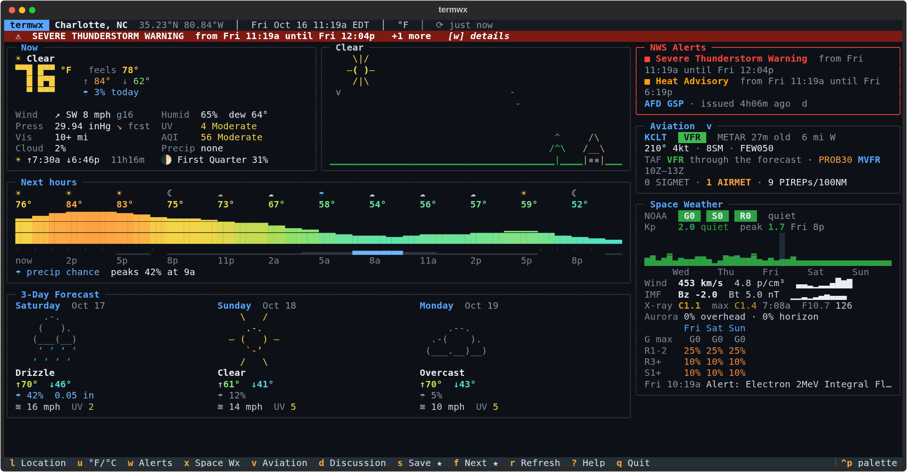

# termwx

Terminal weather and aviation situational awareness: live conditions with an
animated ASCII sky, 24–36h hourly graph, 3-day forecast, NWS severe weather
alerts, a NOAA space weather dashboard, and an aviation console with METAR/TAF,
PIREPs, SIGMETs, G-AIRMETs, CWAs, winds aloft and the NWS forecast discussion.
No API keys.



<sub>Live data for Charlotte, NC (0.2.0), launched with <code>--demo-alert</code> to show the alert banner.</sub>

## Install

```sh
python3 -m venv .venv
.venv/bin/pip install -e .
.venv/bin/termwx
```

Requires Python 3.11+ and a terminal with truecolor + Unicode (most modern terminals).

## Usage

```sh
termwx                          # auto-detects location by IP on first run, then remembers it
termwx -l "Denver, CO"          # city, "City, ST", ZIP code, or "lat,lon"
termwx -u metric                # override units
termwx --once                   # print a snapshot and exit (great for a shell MOTD)
termwx --once --aviation        # …with a larger aviation snapshot (METAR, TAF, advisories, PIREPs, winds)
termwx --airport KCLT           # use this aviation station instead of the nearest one (saved)
termwx --airport auto           # back to the nearest METAR station
termwx --demo-alert             # inject sample alerts to preview the alert UI
termwx --no-anim                # static sky
```

### Keys

| key | action |
|---|---|
| `l` | change location (live search: city, ZIP, lat,lon) |
| `a` | auto-detect location from IP |
| `u` | toggle °F / °C |
| `w` | active alert details (or click the banner) |
| `x` | full space weather dashboard (Kp history + forecast, solar wind, Bz, SWPC bulletins) |
| `v` | aviation screen (METAR, TAF timeline, hazards & PIREPs, winds aloft, field tools) |
| `d` | NWS Area Forecast Discussion, aviation section first |
| `s` / `f` | save current location as favorite / cycle favorites |
| `r` | refresh now |
| `p` | pause animation |
| `V` | send out the sky visitor now |
| `?` | help · `q` quit |

On the aviation screen: `c` choose airport (ICAO; blank = nearest), `h` enter a runway
number or magnetic heading, `[` / `]` cycle published runways, `r` refresh, `esc` back.

## What's on screen

- **Now** — big temperature, feels-like, today's high/low, wind + gusts + direction,
  humidity/dew point, pressure with its *forecast* change over the next 3 hours (labelled
  `fcst` — model output, not a measured pressure tendency), UV, visibility, US AQI, cloud
  cover, sunrise/sunset, moon phase.
- **Sky** — animated scene driven by current conditions: sun/moon, clouds drifting with the
  wind, rain slanting with wind direction, snow, drizzle, fog bands, lightning, stars at night.
  Every 8–15 minutes a little visitor runs out of the house and holds up a sign: an
  inspirational quote, fun fact, trivia question, dinner idea, top news headline or joke,
  pulled live from free APIs (built-in lines if you're offline). Press `V` to call one now.
- **Next hours** — temperature graph colored on a cold→hot ramp, precip-chance bars, condition glyphs.
- **3-Day Forecast** — wttr.in-style icon cards with highs/lows, precip chance and amount, wind, UV.
- **NWS Alerts** — active watches/warnings/advisories for your exact point. New alerts
  ring the terminal bell, pop a toast, and send a desktop notification (`notify-send`).
  Extreme/Severe alerts pulse the banner.
- **Space Weather** — NOAA G/S/R scales, planetary Kp (observed + 3-day forecast), real-time
  solar wind speed/density, IMF Bt/Bz, GOES X-ray flare class, F10.7, OVATION aurora probability
  overhead and on your horizon, 3-day storm/blackout probabilities, latest SWPC bulletin.
  SWPC warnings at G3/S3/R3 or higher from the last 24h also appear in the alert banner.
  The NWS Alerts panel also shows when the local Area Forecast Discussion was issued.
- **Aviation** — a four-line summary of the nearest aviation station: identifier, flight
  category and report age, wind/visibility/clouds, TAF trend, and counts of SIGMETs,
  AIRMETs and PIREPs nearby. Press `v` for the full picture.

## Aviation

termwx picks the nearest METAR-reporting station to your weather location (within 75 NM,
preferring one that also issues a TAF if it is only slightly farther), once per location —
not on every refresh. The station and its distance/direction from you are always shown.
If nothing suitable is close, the aviation panel says so instead of quietly using a distant
airport. `--airport KCLT` (or `c` on the aviation screen) overrides the choice.

The aviation screen (`v`) shows:

- **Header** — `KCLT · Charlotte/Douglas Intl · 6 mi W`, the observation age, and an
  offline/cached warning when applicable.
- **METAR** — flight category (VFR / MVFR / IFR / LIFR), METAR or SPECI and its age, wind,
  visibility, ceiling, clouds, weather, temperature/dew point, altimeter, the measured 3-hour
  pressure tendency when reported, and the raw report.
- **Field tools** — density altitude (field elevation, temperature, altimeter and dew point);
  a headwind/crosswind calculator for a runway (published runways come from AWC's FAA-sourced
  airport data, otherwise enter a runway or heading with `h`; METAR wind, reported in degrees
  true, is converted to magnetic using the airport's published variation); and the last six
  observations with a rule-based improving / steady / deteriorating trend.
- **TAF timeline** — one row per FM/BECMG/TEMPO/PROB group with category, wind, visibility,
  clouds and weather, marking deteriorating (▼) and improving (▲) changes, a one-line outlook
  (`TAF VFR → MVFR 00Z · PROB30 IFR 16Z–20Z`), and the complete raw TAF.
- **Hazards & PIREPs** — SIGMETs (convective and non-convective), G-AIRMETs (CONUS — the
  text AIRMETs they replaced are obsolete), Alaska AIRMETs, international SIGMETs outside the
  lower 48, and Center Weather Advisories that cover the station or come within 50 NM, as
  compact cards with altitudes, time left and movement. PIREPs/AIREPs within 100 NM from the
  last 3 hours, severe/urgent first, then moderate turbulence/icing, then low ceilings or
  weather, then the rest by distance and age. Select any item for the full official text.
- **Winds aloft** — forecast wind and temperature at 3,000–24,000 ft from the nearest FD
  site, highlighting strong winds, levels near 0 °C, large direction changes, and an
  interpolated freezing level.

**This is weather information, not a flight-planning product.** It does not replace an
official preflight weather briefing, NOTAMs, or the formal products they are drawn from.

**NOTAMs** are not shown. The FAA's machine-to-machine NOTAM service requires registration
and credentials (and termwx does not scrape web pages), so the aviation screen says
"NOTAM provider not configured". `src/termwx/api/faa_notam.py` marks where a credentialed
provider could plug in later, reading credentials from environment variables only.

## Refresh & offline

| product | refresh |
|---|---|
| Weather | 10 min |
| NWS alerts | 2 min |
| Space weather | 5 min |
| METAR / SPECI (with 6h history) | 5 min |
| TAF | 10 min |
| SIGMET / G-AIRMET / CWA and PIREPs | 5 min |
| Area Forecast Discussion | 20 min (re-downloaded only when a new one is issued) |
| Winds aloft | 30 min |
| Aviation station and runways | only when the location or chosen airport changes |

Every product is fetched and cached independently in `~/.cache/termwx`: a PIREP outage never
takes down METARs, weather or space weather. If the network drops, the last data is shown and
marked: the top bar says **offline – showing cached data**, and every aviation product that
came from the cache says **offline · cached Nm ago**. Observation and issue ages are always
shown (`METAR 2h18m old` turns amber after 75 minutes and red after 3 hours), expired
advisories are dropped even from the cache, and an expired TAF is labelled as such — old
aviation data is never presented as current.

termwx is a polite client of the Aviation Weather Center's Data API: it identifies itself
with a descriptive User-Agent, uses only documented parameters, asks for small, targeted
results, makes about one request per minute on average (far below AWC's 100 requests/minute
limit), treats HTTP 204 as "no data" rather than an error, and backs off to the cache on
HTTP 429.

## Configuration

`~/.config/termwx/config.toml` (written automatically):

```toml
units = "imperial"      # or "metric"
desktop_notify = true   # notify-send for new alerts
bell = true             # terminal bell for new alerts
animate = true
visitor = true         # sky visitor with quotes, facts, jokes and headlines
aviation_station = "KCLT"  # only present when you chose an airport; omit for the nearest

[location]
name = "Charlotte"
lat = 35.22709
lon = -80.84313
region = "North Carolina"
country_code = "US"
timezone = "America/New_York"

[[favorites]]
# …same fields as [location]
```

## Data sources

| | |
|---|---|
| Forecast, air quality, geocoding | [Open-Meteo](https://open-meteo.com/) (CC BY 4.0, non-commercial) |
| Severe weather alerts, Area Forecast Discussions | [NWS API](https://www.weather.gov/documentation/services-web-api) — US & territories only |
| Aviation (METAR, TAF, PIREP, SIGMET, G-AIRMET, AIRMET, CWA, winds aloft, stations, runways) | [Aviation Weather Center Data API](https://aviationweather.gov/data/api/) |
| Space weather | [NOAA SWPC](https://services.swpc.noaa.gov/) |
| IP location | [ipinfo.io](https://ipinfo.io/) (fallback ipapi.co) |
| Sky visitor signs | ZenQuotes, DummyJSON, Advice Slip, catfact.ninja, Dog API, Useless Facts, Wikipedia On This Day, Open Trivia DB, TheMealDB, NPR & BBC RSS, icanhazdadjoke, JokeAPI, Official Joke API, chucknorris.io, kanye.rest |

Inspired by [wttr.in](https://github.com/chubin/wttr.in), weathr, weather-tui and Stormy.

## Project status

**Version 0.2.0** — the weather dashboard from 0.1 plus the aviation console. Everything
listed above is implemented. The 131 tests pass against recorded fixtures, and the app has been
run against the live services for Charlotte, Denver and Tampa.

| area | status |
|---|---|
| Weather, alerts, space weather | done in 0.1; the pressure change is now labelled `fcst` |
| Sky visitor | done (new since 0.1); its key moved from `v` to `V` |
| HTTP layer | 204 = empty result, 429 falls back to cache, User-Agent identifies this repo |
| Aviation station selection, `--airport`, `aviation_station` | done |
| METAR / SPECI, 6-report trend | done |
| TAF timeline (FM, BECMG, TEMPO, PROB) | done |
| PIREPs / AIREPs, sorted by significance | done |
| SIGMET, G-AIRMET, Alaska AIRMET, international SIGMET, CWA | done |
| Area Forecast Discussion (`d`) | done |
| Density altitude, crosswind calculator | done |
| Winds aloft | done |
| `--once` aviation block, `--once --aviation` | done |
| NOTAMs | **not implemented** — needs FAA API credentials; only a placeholder module exists |

### Known limitations

- **Station choice is a heuristic.** It takes the nearest METAR site within 75 NM and prefers
  a TAF site that is up to 8 NM farther. That can pick a field you wouldn't (downtown Denver
  gets Buckley SFB, not KDEN). Use `--airport` or `c` to override.
- **Domestic non-convective SIGMETs** (e.g. `SIGMET NOVEMBER 3`) are only tested with a
  hand-built record. None were active when the fixtures were recorded.
- **G-AIRMETs** show the current snapshot only, not the 3/6/9/12-hour forecast snapshots.
  Freezing-level lines are parsed but not used to decide which advisories apply.
- **Alaska AIRMETs** show zone, hazard and times only. The API doesn't supply their text.
- **TAF icing and turbulence groups** are parsed but not yet shown in the timeline (the raw
  TAF below it has them).
- **Winds aloft** use the low-level bulletin. 22 of 233 bulletin sites (mostly offshore grid
  points) have no coordinates in `fd_sites.json` and are never chosen. Levels above 24,000 ft
  are parsed but not displayed.
- **Runway headings** come from runway numbers (18 → 180°), not surveyed headings, which is
  the usual approximation for crosswind estimates.
- **PIREP search radius:** AWC doesn't document the unit of its `distance` parameter, so termwx
  over-asks slightly and trims to 100 NM itself.
- **US coverage only** for NWS alerts and forecast discussions. METAR/TAF and international
  SIGMETs work elsewhere, but have only been checked for US locations.

### Code layout

| module | role |
|---|---|
| `api/openmeteo.py`, `api/geo.py` | forecast, air quality, geocoding |
| `api/nws.py` | alerts, forecast office lookup, Area Forecast Discussion |
| `api/swpc.py` | space weather |
| `api/awc.py` | all Aviation Weather Center products, normalized at the boundary |
| `api/faa_notam.py` | placeholder for a future credentialed NOTAM provider |
| `api/quips.py` | sky visitor signs |
| `models.py`, `aviation_models.py` | dataclasses for general weather / aviation |
| `aviation.py` | pure calculations: geometry, categories, density altitude, wind, trends |
| `render.py`, `render_aviation.py` | Rich renderers shared by the TUI and `--once` |
| `screens.py`, `screens_aviation.py` | general screens / aviation, discussion and prompt screens |
| `app.py`, `once.py` | the Textual app and the non-interactive snapshot |

### Possible next steps

- A NOTAM provider using the FAA API, opt-in through environment variables.
- Showing TAF icing/turbulence groups and G-AIRMET forecast snapshots.

## Development

```sh
.venv/bin/pip install -e '.[dev]'
.venv/bin/pytest
```

Tests run entirely against recorded API responses in `tests/fixtures/` (no network access),
including Textual Pilot tests of the location search, units toggle, alerts, space weather,
aviation and forecast discussion screens. Aviation fixtures were recorded on 2026-10-07 and
the tests pin the aviation clock to that time.

Winds-aloft bulletins name their sites only by identifier, so termwx ships their coordinates
in `src/termwx/data/fd_sites.json`. Regenerate it from AWC station data with
`.venv/bin/python scripts/build_fd_sites.py`.
